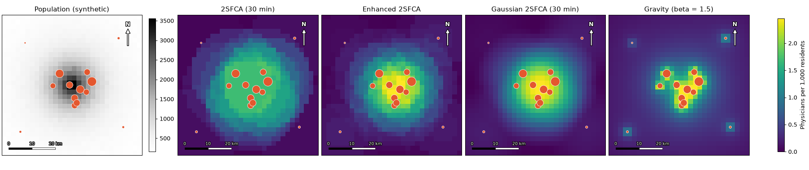

# healthcare-access

**Measure spatial access to healthcare with floating catchment area (FCA) and gravity models, in a few lines of Python.**

[](https://github.com/rajibhossain26/healthcare-access/actions/workflows/tests.yml)
[](https://pypi.org/project/healthcare-access/)


"How many doctors can people here actually reach?" A simple provider-to-population ratio by county hides the answer. People cross county lines, and a clinic 5 minutes away matters more than one 40 minutes away. FCA models answer the question using travel time and competition for providers. They are the standard methods in health geography and in US shortage-area research.


*The same synthetic county under four models. Red dots are clinics, sized by number of physicians. The data is synthetic, generated by [`examples/synthetic_county_demo.py`](https://github.com/rajibhossain26/healthcare-access/blob/main/examples/synthetic_county_demo.py).*

## What's included

| Model | Function | Reference |
| --- | --- | --- |
| Two-step FCA | `two_step_fca` | Luo & Wang (2003) |
| Enhanced 2SFCA (stepwise travel-time zones) | `enhanced_2sfca` | Luo & Qi (2009) |
| Gaussian / kernel 2SFCA | `gaussian_2sfca` | Dai (2010) |
| Three-step FCA (selection weights for overlapping catchments) | `three_step_fca` | Wan, Zou & Sternberg (2012) |
| Modified 2SFCA (squared distance weights) | `modified_2sfca` | Delamater (2013) |
| Gravity model with competition | `gravity` | Joseph & Bantock (1982) |
| Any decay function you write | `fca(..., decay_fn)` | |
| Nearest provider, providers within X minutes | `nearest_provider_cost`, `providers_within` | |

The package also includes:

- **Travel-cost helpers:** haversine and Euclidean matrices, origin-destination table pivoting, network shortest paths with `networkx` that respect one-way streets, and an OpenStreetMap drive-time helper (`osmnx`).
- **Equity summaries:** population-weighted Gini, share of people below a shortage threshold, and group comparisons (e.g. urban vs rural).

## Install

```bash
pip install healthcare-access            # add [osm] for OpenStreetMap drive times
```

The import name is `healthaccess`. To install the latest code from GitHub instead:

```bash
pip install "git+https://github.com/rajibhossain26/healthcare-access.git"
```

For development:

```bash
git clone https://github.com/rajibhossain26/healthcare-access.git
cd healthcare-access
pip install -e ".[examples,dev]"
```

## Quick start

```python
import pandas as pd
import healthaccess as ha

population = pd.Series({"A": 100, "B": 300})            # people per neighborhood
physicians = pd.Series({"X": 2, "Y": 1})                # providers per clinic
minutes = pd.DataFrame({"X": [5, 15], "Y": [25, 8]},    # drive time, neighborhood x clinic
                       index=["A", "B"])

ha.two_step_fca(population, physicians, minutes, threshold=20) * 1000
# A    5.00   physicians per 1,000 residents
# B    8.33
```

**How the numbers come about.** Clinic X is within 20 minutes of both neighborhoods, so its 2 physicians are shared by 400 people (0.005 each). Clinic Y only reaches B, so its 1 physician serves 300 people. B adds both shares and gets 0.0083. The model always conserves supply: population times access, summed over neighborhoods, gives back all 3 physicians. The tests check this property for every model.

### With real data

```python
tracts = ...   # DataFrame indexed by GEOID with lon, lat (centroids) and population (ACS B01003)
clinics = ...  # DataFrame indexed by provider id with lon, lat and physicians (e.g. from NPPES)

minutes = ha.distance.osm_drive_cost_matrix("Clarke County, Georgia, USA",
                                            tracts, clinics, cutoff_minutes=60)
access = ha.enhanced_2sfca(tracts.population, clinics.physicians, minutes)

ha.equity.weighted_gini(access, tracts.population)
ha.equity.share_below(access, tracts.population, threshold=1 / 3500)   # HPSA-style ratio
```

If you already have a travel-time table from ArcGIS Network Analyst (OD Cost Matrix), R5 or OSRM, load it with `ha.distance.from_long(table, "origin", "destination", "minutes")`.

## Choosing a model

- **2SFCA** is the easiest to explain. Everyone inside the catchment counts equally and nobody outside counts at all, which creates sharp edges.
- **Enhanced and Gaussian 2SFCA** add distance decay inside the catchment. They are usually the best default for primary care.
- **Three-step FCA** stops people who can reach several clinics from being counted in full by each one, which matters in dense cities with overlapping catchments.
- **Modified 2SFCA** weights distance twice, so a far-away but uncrowded clinic adds less. It does not conserve total supply, by design.
- **Gravity** has no hard cutoff and is sensitive to `beta`. It is useful for sensitivity analysis.

The synthetic demo shows why the choice matters. On the same county, the share of residents below a 1:3,500 shortage ratio ranges from 20% to 29% depending on the model.

## Run the tests

```bash
pytest
```

## Roadmap

- [x] Three-step FCA (Wan et al. 2012) and Modified 2SFCA (Delamater 2013)
- [x] Published on PyPI
- [ ] GeoDataFrame in, GeoDataFrame out
- [ ] Worked example with real Georgia census tracts and provider data

## Citation

If you use the package, please cite it (GitHub's "Cite this repository" button reads [`CITATION.cff`](https://github.com/rajibhossain26/healthcare-access/blob/main/CITATION.cff)) along with the original paper for the model you used.

## Author

**Rajib Hossain**, PhD researcher in GIScience & environmental health, University of Georgia · [LinkedIn](https://www.linkedin.com/in/hossainrajib)

## References

- Luo, W., & Wang, F. (2003). Measures of spatial accessibility to health care in a GIS environment. *Environment and Planning B*, 30(6), 865–884.
- Luo, W., & Qi, Y. (2009). An enhanced two-step floating catchment area (E2SFCA) method. *Health & Place*, 15(4), 1100–1107.
- Dai, D. (2010). Black residential segregation, disparities in spatial access to health care facilities, and late-stage breast cancer diagnosis in metropolitan Detroit. *Health & Place*, 16(5), 1038–1052.
- Wan, N., Zou, B., & Sternberg, T. (2012). A three-step floating catchment area method for analyzing spatial access to health services. *International Journal of Geographical Information Science*, 26(6), 1073–1089.
- Delamater, P. L. (2013). Spatial accessibility in suboptimally configured health care systems: A modified two-step floating catchment area (M2SFCA) metric. *Health & Place*, 24, 30–43.
- Joseph, A. E., & Bantock, P. R. (1982). Measuring potential physical accessibility to general practitioners in rural areas. *Social Science & Medicine*, 16(1), 85–90.

MIT License
